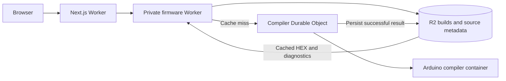

# Cloudflare deployment

The Next.js + Tailwind site runs on Cloudflare Workers through OpenNext. A private firmware Worker validates configuration, reads GitHub source metadata, and checks R2 for completed builds. On a cache miss it calls a Durable Object that starts a Cloudflare Container with Arduino CLI and the AVR toolchain. The container sleeps after five idle minutes. Browser USB upload still uses Web Serial.

Regular Worker isolates cannot execute the native AVR compiler; Cloudflare Containers supply the Linux environment. This deployment needs a Workers Paid account with Containers available and R2 enabled. See [Containers setup](https://developers.cloudflare.com/containers/get-started/) and [pricing](https://developers.cloudflare.com/containers/platform/pricing/).



## First deployment

Install Node.js 22 or newer and pnpm 12.6.0, and run Docker locally. The package manager version is pinned in `package.json`; Corepack can install it with `corepack enable` and `corepack prepare pnpm@12.6.0 --activate`. Wrangler builds a Linux container image; Docker Desktop can build it on an Apple Silicon Mac. The image installs the compiler and libraries during deployment, rather than per firmware request. Local `setup:arduino` is not required for a Cloudflare deployment.

```sh
pnpm install --frozen-lockfile
pnpm exec wrangler login
pnpm run cf:bucket
pnpm run cf:deploy
```

`cf:bucket` creates `cartreader-build-cache` once. Reuse the existing bucket on subsequent deployments. The deploy command first publishes the private firmware Worker and compiler image, then builds and publishes the website. Wrangler reports the website's HTTPS URL. Initial container provisioning can take a few minutes.

Resources are configured in `wrangler.jsonc` (website) and `wrangler.firmware.jsonc` (firmware service). If renaming Workers, update the website's `FIRMWARE_SERVICE` and `WORKER_SELF_REFERENCE` bindings as well. The firmware Worker deliberately has no public `workers.dev` or preview URL; the website reaches it through a service binding. The compiler HTTP port is reachable only through its Durable Object.

For automation, provide `CLOUDFLARE_ACCOUNT_ID` and a Cloudflare API token through your CI secret store with permission to deploy Workers, Containers/registry images, Durable Objects, and the R2 bucket. Keep a Docker daemon available to the deploy job. This repository does not include account IDs or credentials.

## Deploy from a connected Git repository

For Cloudflare Workers Builds, open `cartreader-web-programmer` in **Workers & Pages > Settings > Build** and use:

| Setting | Value |
| --- | --- |
| Root directory | `/` |
| Build command | `pnpm run cf:build` |
| Deploy command | `pnpm run cf:deploy:firmware && pnpm run cf:deploy:web` |

`cf:build` runs Next.js and generates the OpenNext configuration and Worker bundle under `.open-next/`. The default `pnpm run build` also detects Cloudflare's `WORKERS_CI=1` environment and runs this adapter automatically, so the dashboard's default build command works. During the adapter's internal build, the script sets `CARTREADER_NEXT_BUILD=1` to prevent recursion. This works whether or not build variables already set `FIRMWARE_BACKEND=cloudflare`. Outside Workers Builds, `pnpm run build` produces the Node deployment under `.next/`; use `cf:build` explicitly when preparing a Cloudflare bundle locally.

For website-only updates after the firmware service is deployed, `pnpm exec wrangler deploy` can publish the website after either Cloudflare build command. The full deploy command in the table also publishes the firmware service and container; the default Wrangler deploy command only publishes the website.

The deploy command publishes the private firmware service and compiler image before the website, so its `FIRMWARE_SERVICE` binding can resolve. Workers Builds can build the Dockerfile in its own environment; local Docker is only needed when deploying the container from your computer. See [Cloudflare's Containers deployment guide](https://developers.cloudflare.com/containers/guides/deploy/).

Workers Builds supplies `WRANGLER_CI_OVERRIDE_NAME` and `WRANGLER_CI_MATCH_TAG` for the connected website Worker. `cf:deploy:firmware` clears those two values only in the firmware deployment's child process, allowing it to deploy as `cartreader-firmware`. The website deployment keeps the original CI identity checks. Use the package script for firmware deployment in this job: invoking `wrangler deploy --config wrangler.firmware.jsonc` directly would rename the firmware Worker to the website Worker.

Before retrying the build, enable Workers Paid and R2 in the dashboard, then create `cartreader-build-cache` once through the dashboard or `pnpm run cf:bucket`. The build token must have permission to deploy both Workers, their Durable Object namespace, and Containers/registry images, and to access the R2 bucket. Cloudflare build settings are stored in the dashboard; changing this repository does not update an existing trigger's commands. See [Workers Builds configuration](https://developers.cloudflare.com/workers/ci-cd/builds/configuration/).

If deployment fails with `R2 bucket 'cartreader-build-cache' not found` (code 10085), open **R2 Object Storage** in the same account as the Workers, complete R2 activation if prompted, and create a bucket named exactly `cartreader-build-cache`. Declaring the binding in `wrangler.firmware.jsonc` does not create this named bucket. If `cf:bucket` reports `Please enable R2 through the Cloudflare Dashboard` (code 10042), activation must be completed in the dashboard first. Then retry the deployment; no firmware settings need changing.

If installation fails with `ERR_PNPM_MINIMUM_RELEASE_AGE_VIOLATION`, pnpm is rejecting dependencies published within its default 24-hour waiting period. `pnpm-workspace.yaml` lists exact-version exceptions for the Next.js and Cloudflare dependency versions already used in the verified build, including platform-specific SWC packages. These exceptions do not apply to future versions or unrelated packages. Keep the workspace file committed with the lockfile so a fresh CI install uses the same policy.

## GitHub and custom domains

The firmware Worker resolves commits through GitHub's REST API. If that endpoint returns 403 or 429, it falls back to public Git smart HTTP ref discovery, following the current advertised HEAD or the selected published release tag. Annotated tags use their peeled commit. The fallback validates the complete ref advertisement and does not substitute expired metadata. Release discovery still uses the REST API; a read-only GitHub token increases its rate allowance for a public installation:

```sh
pnpm exec wrangler secret put GITHUB_TOKEN --config wrangler.firmware.jsonc
```

The token is sent only to `api.github.com`; it is never sent to browsers, public Git ref discovery, raw source downloads, or the compiler. Latest repository HEAD is resolved again after a 60-second metadata cache. Published releases and release refs refresh after five minutes. Resolved source projects remain available by exact commit so a visitor can build the version they configured even after upstream changes.

For a custom domain, configure a Workers custom domain for `cartreader-web-programmer` in Cloudflare or add the corresponding route to `wrangler.jsonc`. HTTPS is necessary for Web Serial. Build requests enforce the incoming same origin by default. An optional `APP_ORIGIN` environment variable restricts builds to one explicit public origin; set it on the website and firmware Workers if using it. Setting it will also reject builds from alternate preview domains.

## Build caching

Every successful build is stored in R2 as `builds/<sha256>.json`, containing application HEX, generated Config.h, compiler diagnostics, memory usage, source revision, and build timestamp. The full key covers:

- Resolved firmware commit, for both latest and release sources.
- Generated Config.h, rather than the order of properties in the request.
- Target board, Arduino CLI, AVR core, all library versions, and compiler recipe from `toolchain.json`.

Equivalent settings reuse a result across visitors, Worker instances, container restarts, and redeployments. A different commit, configuration, or toolchain produces a different key. Cache hits are returned directly from R2 without starting the compiler container. The API reports `X-Firmware-Cache: HIT` or `MISS`, and the interface labels reused builds.

The globally named `shared-compiler` Durable Object rechecks R2 before building. It coalesces simultaneous identical jobs and serializes different jobs, with at most eight distinct active/queued builds. Excess requests receive a retry response. Structured errors retain their status and diagnostics across Durable Object RPC. Only successful builds are cached, and the R2 write finishes before the result is returned. An instance failure before persistence may require retrying a build; completed R2 entries remain reusable.

The container limit is one instance. Raising `max_instances` alone does not introduce parallel compilers: the routing and coordination use one named object. Scale only after adding deliberate build routing/coordination. The Node development server also caches successful builds under `.firmware-cache/builds/`, with the same keys and coordination logic.

Cached builds have no application expiry. Do not add an R2 expiration rule to `builds/` if you want future requests to reuse every completed build. Delete a specific R2 object to force that build to compile again. If changing compiler behavior without changing a toolchain version, increment `recipe` in `toolchain.json`; redeploy the firmware service and website together. Cloudflare configuration does not pin the latest source to a commit.

## Local checks and preview

```sh
pnpm test
pnpm run typecheck
pnpm run cf:build
pnpm exec wrangler deploy --config wrangler.jsonc --dry-run
pnpm run cf:deploy:firmware --dry-run --containers-rollout none
```

The final command validates the firmware Worker bundle while skipping Docker image construction. For a complete local Cloudflare preview with Docker running:

```sh
# Terminal 1: private firmware Worker, local R2 and compiler container
pnpm run cf:dev:firmware

# Terminal 2: the already-built website Worker
pnpm run cf:preview
```

Both Wrangler sessions must use the same local development registry so the service binding resolves. The preview uses local R2 rather than production data. A local GitHub token can be placed in `.dev.vars` for the firmware Worker; these files are ignored by Git. Ordinary `pnpm run dev` continues to use the local Node compiler, requiring `pnpm run setup:arduino`.

## Verification performed

32 automated tests cover request validation, source resolution, cache invalidation, property-order equivalence, persistent result reuse, simultaneous identical requests, serialization, retry after failure, configuration generation, upload protocol behavior, firmware deployment identity inside a website CI job, and the global fetch receiver required by Workers. Source tests also cover REST 403/429 fallback, following changes to HEAD, annotated release tags, credential isolation, and rejection of malformed or truncated Git advertisements. TypeScript and the OpenNext Cloudflare build pass. Wrangler dry runs validate both Worker bundles. Local Workers runtime probes validate API service forwarding, streamed POST bodies and content types, and the global fetch receiver using mocked upstream responses.

The compiler HTTP service was exercised against the local R2 emulator: V15.6/HW5 compiled to 181,796 bytes of flash and 5,234 bytes of RAM; a second request with reordered identical settings returned a cache hit without invoking the compiler. The supplied Workers Builds logs confirm successful Docker image construction, including Arduino CLI and library installation. After R2 activation and the Workers Paid upgrade, Cloudflare reports a successful website deployment and an existing compiler container application. The fetch receiver and request-wrapper fixes are deployed. On October 2, live checks reproduced an intermittent GitHub 403 from the firmware API while a later homepage request succeeded. The new fallback was verified against real public GitHub refs and source files with a simulated REST 403, loading V15.6 and its 73 configuration options; it needs redeployment. A firmware compilation and subsequent cache hit through the deployed website remain to be verified.
