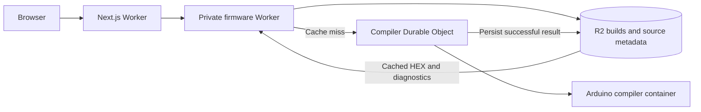

# Cloudflare deployment

The Next.js + Tailwind site runs on Cloudflare Workers through OpenNext. A private firmware Worker validates configuration, reads GitHub source metadata, and checks R2 for completed builds. On a cache miss it calls a Durable Object that starts a Cloudflare Container with Arduino CLI and the AVR toolchain. The container sleeps after five idle minutes. Browser USB upload still uses Web Serial.

Regular Worker isolates cannot execute the native AVR compiler; Cloudflare Containers supply the Linux environment. This deployment needs a Workers Paid account with Containers available and R2 enabled. See [Containers setup](https://developers.cloudflare.com/containers/get-started/) and [pricing](https://developers.cloudflare.com/containers/platform/pricing/).



## First deployment

Install Node.js 22 or newer and run Docker locally. Wrangler builds a Linux container image; Docker Desktop can build it on an Apple Silicon Mac. The image installs the compiler and libraries during deployment, rather than per firmware request. Local `setup:arduino` is not required for a Cloudflare deployment.

```sh
npm ci
npx wrangler login
npm run cf:bucket
npm run cf:deploy
```

`cf:bucket` creates `cartreader-build-cache` once. Reuse the existing bucket on subsequent deployments. The deploy command first publishes the private firmware Worker and compiler image, then builds and publishes the website. Wrangler reports the website's HTTPS URL. Initial container provisioning can take a few minutes.

Resources are configured in `wrangler.jsonc` (website) and `wrangler.firmware.jsonc` (firmware service). If renaming Workers, update the website's `FIRMWARE_SERVICE` and `WORKER_SELF_REFERENCE` bindings as well. The firmware Worker deliberately has no public `workers.dev` or preview URL; the website reaches it through a service binding. The compiler HTTP port is reachable only through its Durable Object.

For automation, provide `CLOUDFLARE_ACCOUNT_ID` and a Cloudflare API token through your CI secret store with permission to deploy Workers, Containers/registry images, Durable Objects, and the R2 bucket. Keep a Docker daemon available to the deploy job. This repository does not include account IDs or credentials.

## GitHub and custom domains

Anonymous GitHub API calls have low rate limits. Add a read-only GitHub token to the firmware Worker for a public installation:

```sh
npx wrangler secret put GITHUB_TOKEN --config wrangler.firmware.jsonc
```

The token is sent only to `api.github.com`; it is never sent to browsers, raw source downloads, or the compiler. Latest repository HEAD is resolved again after a 60-second metadata cache. Published releases and release refs refresh after five minutes. Resolved source projects remain available by exact commit so a visitor can build the version they configured even after upstream changes.

For a custom domain, configure a Workers custom domain for `cartreader-web-programmer` in Cloudflare or add the corresponding route to `wrangler.jsonc`. HTTPS is necessary for Web Serial. Build requests enforce the incoming same origin by default. An optional `APP_ORIGIN` environment variable restricts builds to one explicit public origin; set it on the website and firmware Workers if using it. Setting it will also reject builds from alternate preview domains.

## Build caching

Every successful build is stored in R2 as `builds/<sha256>.json`, containing application HEX, generated Config.h, compiler diagnostics, memory usage, source revision, and build timestamp. The full key covers:

- Resolved firmware commit, for both latest and release sources.
- Generated Config.h, rather than the order of properties in the request.
- Target board, Arduino CLI, AVR core, all library versions, and compiler recipe from `toolchain.json`.

Equivalent settings reuse a result across visitors, Worker instances, container restarts, and redeployments. A different commit, configuration, or toolchain produces a different key. Cache hits are returned directly from R2 without starting the compiler container. The API reports `X-Firmware-Cache: HIT` or `MISS`, and the interface labels reused builds.

The globally named `shared-compiler` Durable Object rechecks R2 before building. It coalesces simultaneous identical jobs and serializes different jobs, with at most eight distinct active/queued builds. Excess requests receive a retry response. Structured errors retain their status and diagnostics across Durable Object RPC. Only successful builds are cached, and the R2 write finishes before the result is returned. An instance failure before persistence may require retrying a build; completed R2 entries remain reusable.

The container limit is one instance. Raising `max_instances` alone does not introduce parallel compilers: the routing and coordination use one named object. Scale only after adding deliberate build routing/coordination. The Node development server also caches successful builds under `.firmware-cache/builds/`, with the same keys and coordination logic.

Cached builds have no application expiry. Do not add an R2 expiration rule to `builds/` if you want future requests to reuse every completed build. Delete a specific R2 object to force that build to compile again. If changing compiler behavior without changing a toolchain version, increment `recipe` in `toolchain.json`; redeploy the firmware service and website together. Cloudflare configuration does not pin the latest source to a commit.

## Local checks and preview

```sh
npm test
npm run typecheck
npm run cf:build
npx wrangler deploy --config wrangler.jsonc --dry-run
npx wrangler deploy --config wrangler.firmware.jsonc --dry-run --containers-rollout none
```

The final command validates the firmware Worker bundle while skipping Docker image construction. For a complete local Cloudflare preview with Docker running:

```sh
# Terminal 1: private firmware Worker, local R2 and compiler container
npm run cf:dev:firmware

# Terminal 2: the already-built website Worker
npm run cf:preview
```

Both Wrangler sessions must use the same local development registry so the service binding resolves. The preview uses local R2 rather than production data. A local GitHub token can be placed in `.dev.vars` for the firmware Worker; these files are ignored by Git. Ordinary `npm run dev` continues to use the local Node compiler, requiring `npm run setup:arduino`.

## Verification performed

25 automated tests cover request validation, source resolution, cache invalidation, property-order equivalence, persistent result reuse, simultaneous identical requests, serialization, retry after failure, configuration generation, and upload protocol behavior. TypeScript and the OpenNext Cloudflare build pass. Wrangler dry runs validate both Worker bundles.

The compiler HTTP service was exercised against the local R2 emulator: V15.6/HW5 compiled to 181,796 bytes of flash and 5,234 bytes of RAM; a second request with reordered identical settings returned a cache hit without invoking the compiler. Docker image construction and a live Cloudflare deployment still require acceptance testing because Docker is unavailable on this machine. No live deployment has been performed.
